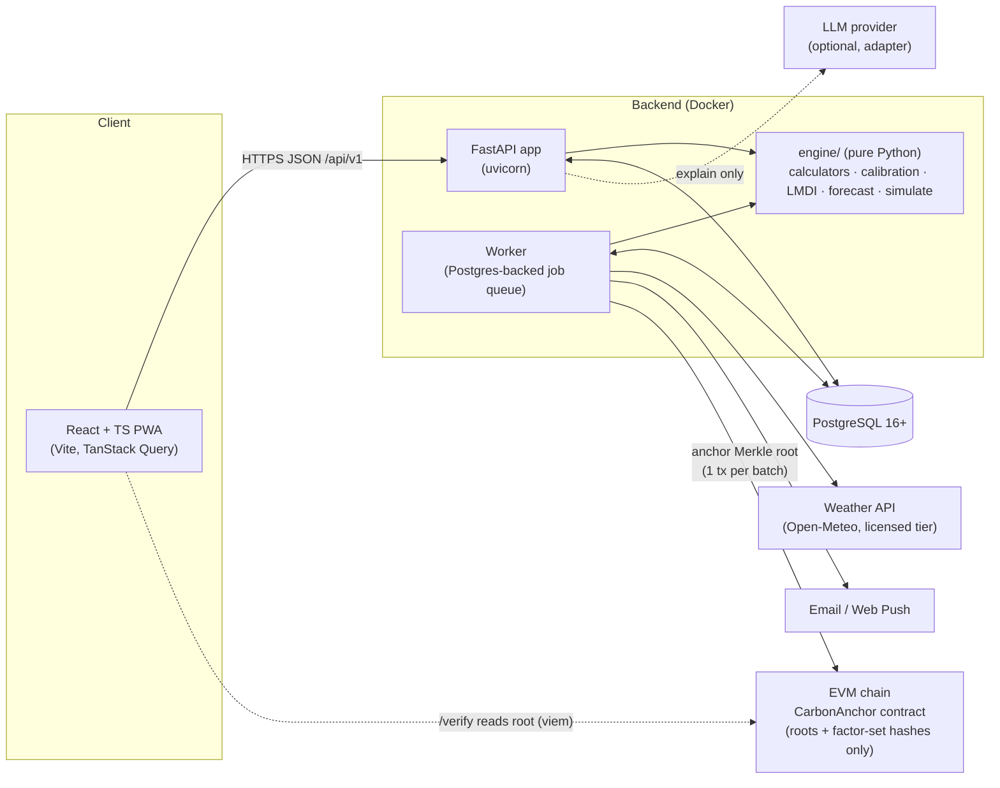
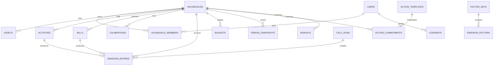
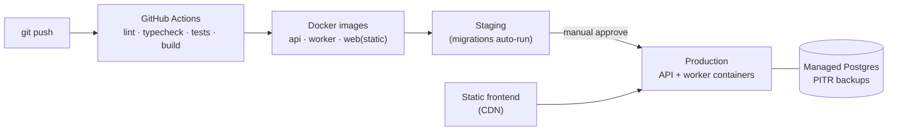

# Carbon Wallet — Architecture

> How [system_design.md](system_design.md) is built with **FastAPI · PostgreSQL · React + TypeScript**.

---

## 1. Architectural style

**A modular monolith with a pure calculation core.**

- One FastAPI service and one PostgreSQL database. Background jobs run from the same codebase in a separate worker process.
- Modules have strict boundaries (separate routers, services, and models). They talk through service interfaces, not each other's tables.
- The **engine** (`app/engine`) is plain Python with **zero** FastAPI, SQLAlchemy, or network imports. That keeps it fully unit-testable, reusable by the simulator, and easy to extract later if needed.

**Why not microservices?** The load is tiny (thousands of users, a few writes per user per week). The hard problems are correctness and trust, not scale. One deployable means one transaction boundary, simple recomputation, and less to operate.



---

## 2. Tech stack

| Layer | Choice | Why |
|---|---|---|
| Language | Python 3.12+ | Team stack; strong numeric and data libraries |
| API | **FastAPI** + Pydantic v2 | Typed schemas; automatic OpenAPI used for frontend codegen |
| ASGI server | uvicorn (behind a reverse proxy) | Standard |
| ORM / DB access | SQLAlchemy 2.0 (async) + asyncpg | Mature; typed `Mapped[]` models |
| Migrations | Alembic | Standard with SQLAlchemy |
| Database | **PostgreSQL 16+** | JSONB for activity payloads, `NUMERIC` for kg, partial indexes, optional RLS, and a job queue without Redis |
| Jobs / cron | Postgres-backed queue (`procrastinate`, or a `jobs` table with `FOR UPDATE SKIP LOCKED`) | No extra infrastructure; jobs are transactional with data writes |
| Auth | argon2id password hashing · short-lived access token + rotating refresh token in an `httpOnly` `SameSite=Lax` cookie | Avoids tokens in localStorage |
| Env / tooling | `uv`, `ruff`, `mypy` (strict on `engine/`), `pytest`, `hypothesis` | Fast and strict |
| Frontend | **React + TypeScript**, Vite | Team stack |
| Server state | TanStack Query | Caching, retries, optimistic check-ins |
| Routing | React Router | Standard |
| Forms | React Hook Form + Zod | Same validation on onboarding and check-ins |
| UI | Tailwind CSS + shadcn/ui (Radix) | Accessible primitives |
| Charts | Recharts (or visx) | Stacked bars with range whiskers |
| API client | `openapi-typescript` (+ `openapi-fetch`) generated from FastAPI's `/openapi.json` | Backend and frontend types can't drift; CI fails on a stale client |
| i18n | `i18next` | English + Hindi |
| PWA | `vite-plugin-pwa` (Workbox) | Install prompt, offline check-ins, web push (iOS needs an installed PWA) |
| Tests (FE) | Vitest + Testing Library · Playwright (E2E) | |
| Observability | structlog (JSON) · OpenTelemetry · Sentry | |
| Blockchain (anchoring) | Solidity + OpenZeppelin v5 · Foundry · `web3.py` (backend signer) · `viem` (frontend verify) | Tamper-evident statements and factor sets; see [blockchain.md](blockchain.md) |
| Packaging | Docker + docker-compose (dev) | |
| CI | GitHub Actions | |

---

## 3. Repository layout (monorepo)

```
carbon-wallet/
├── backend/
│   ├── app/
│   │   ├── main.py                 # FastAPI app factory, routers, middleware
│   │   ├── core/                   # config, db session, security, errors (RFC 9457), logging
│   │   ├── engine/                 # ★ pure calc core — no I/O
│   │   │   ├── types.py            # Estimate, FactorRef, EmissionLine, Tier, Scope
│   │   │   ├── uncertainty.py      # log-normal RSS / Monte Carlo
│   │   │   ├── units.py
│   │   │   ├── factors.py          # FactorResolver protocol (as_of, region, key)
│   │   │   ├── calculators/
│   │   │   │   ├── electricity.py  # bill → scope2 + T&D lines
│   │   │   │   ├── ac.py           # AC sub-allocation (moves kWh, never adds)
│   │   │   │   ├── refrigerant.py
│   │   │   │   ├── transport.py
│   │   │   │   ├── cooking.py
│   │   │   │   ├── food.py
│   │   │   │   └── flight.py
│   │   │   ├── calibration.py      # bill regression → (b, k)
│   │   │   ├── weather.py          # CDD, seasonal index
│   │   │   ├── baseline.py         # baseline + glide path
│   │   │   ├── forecast.py
│   │   │   ├── decomposition.py    # LMDI
│   │   │   ├── simulate.py         # profile patch → Δ
│   │   │   ├── actions.py          # ranking + greedy recovery plan
│   │   │   └── score.py
│   │   ├── modules/                # each: router.py, service.py, models.py, schemas.py
│   │   │   ├── auth/
│   │   │   ├── households/
│   │   │   ├── assets/
│   │   │   ├── activities/
│   │   │   ├── bills/
│   │   │   ├── factors/
│   │   │   ├── ledger/             # emission_entries, calc_runs, snapshots
│   │   │   ├── budgets/
│   │   │   ├── insights/
│   │   │   ├── simulator/
│   │   │   ├── actions/
│   │   │   ├── scores/
│   │   │   ├── notifications/
│   │   │   ├── coach/              # optional LLM adapter + number guard
│   │   │   ├── anchoring/          # statements, Merkle batches, on-chain anchor (blockchain.md)
│   │   │   └── privacy/            # consent, export, erasure (+ salt crypto-shredding)
│   │   └── jobs/                   # task definitions + schedules
│   ├── migrations/                 # Alembic
│   ├── tests/
│   │   ├── engine/golden/          # hand-computed fixtures (YAML) → expected kg
│   │   ├── engine/properties/      # hypothesis
│   │   └── api/
│   └── pyproject.toml
├── factors/                        # ★ factor data as code
│   ├── IN-2026.1/
│   │   ├── electricity.yaml
│   │   ├── cooling.yaml
│   │   ├── transport.yaml
│   │   └── food.yaml
│   └── schema.json
├── frontend/
│   ├── src/
│   │   ├── app/                    # router, providers, query client, i18n
│   │   ├── api/                    # generated types + typed fetch client + query hooks
│   │   ├── features/
│   │   │   ├── onboarding/
│   │   │   ├── wallet/
│   │   │   ├── checkin/
│   │   │   ├── bills/
│   │   │   ├── assets/
│   │   │   ├── insights/
│   │   │   ├── simulator/
│   │   │   ├── plan/               # actions + commitments
│   │   │   ├── score/
│   │   │   ├── methodology/
│   │   │   └── settings/           # privacy, export, delete
│   │   ├── components/             # ui/ (shadcn), charts/, EstimateBadge, TierChip
│   │   └── lib/                    # format (kg, ₹ en-IN), dates, zod schemas
│   └── package.json
├── contracts/                      # Foundry project: CarbonAnchor.sol + tests + deploy script
├── docs/                           # these .md files + ADRs
├── docker-compose.yml
└── .github/workflows/
```

---

## 4. The engine (pure core)

### 4.1 Core types

```python
# app/engine/types.py
from dataclasses import dataclass, field
from enum import StrEnum
from datetime import date

class Tier(StrEnum):
    MEASURED = "measured"; BILL_CALIBRATED = "bill_calibrated"
    DECLARED = "declared"; DEFAULT = "default"

class Scope(StrEnum):
    S1 = "scope1"; S2_LOCATION = "scope2_location"; S2_MARKET = "scope2_market"; S3 = "scope3"

@dataclass(frozen=True)
class Estimate:
    central: float          # kg CO2e
    low: float
    high: float

@dataclass(frozen=True)
class FactorRef:
    id: str; key: str; value: float; low: float; high: float; unit: str; set_version: str

@dataclass(frozen=True)
class EmissionLine:
    entry_date: date
    category: str            # electricity | cooling | refrigerant | transport | food | cooking | flight
    subcategory: str         # e.g. "ac:ac_1", "residual_home", "car:hatch_1"
    scope: Scope
    kg: Estimate
    tier: Tier
    factors: tuple[FactorRef, ...]
    inputs: dict = field(default_factory=dict)
    essential: bool = False  # heat-alert cooling
```

### 4.2 Calculator contract

```python
# app/engine/calculators/base.py
from typing import Protocol, ClassVar
from collections.abc import Sequence

class FactorResolver(Protocol):
    def get(self, key: str, *, as_of: date, region: str) -> FactorRef: ...

@dataclass(frozen=True)
class CalcContext:
    factors: FactorResolver
    household: "HouseholdProfile"      # assets, calibration (b, k), members, region
    weather: "WeatherSeries"           # daily CDD, heat alerts
    calc_version: str                  # e.g. "2026.10.0"

class Calculator(Protocol):
    activity_type: ClassVar[str]
    def compute(self, activity: "ActivityInput", ctx: CalcContext) -> Sequence[EmissionLine]: ...
```

Rules enforced by tests:

1. **Determinism.** The same `(activity, ctx)` always gives identical output.
2. **No double counting.** The AC calculator *re-labels* part of the bill's kWh from `residual_home` to `cooling`. The sum of all electricity lines must equal `bill_kWh × EF`, and a property test checks this.
3. **Monotonicity.** More km, kWh, or hours never lowers emissions. Checked with hypothesis.
4. **Range sanity.** `low ≤ central ≤ high` and every value is ≥ 0.

### 4.3 Simulator reuses calculators

```python
def simulate(profile: HouseholdProfile, patches: list[Patch], period: Period, ctx: CalcContext) -> SimResult:
    base  = run_period(profile, period, ctx)
    alt   = run_period(apply_patches(profile, patches), period, ctx)
    return diff(base, alt)          # Δ kg (range), Δ kWh, Δ ₹ via tariff module
```

Savings and footprints come from the same code path, so they cannot disagree.

---

## 5. Data model

### 5.1 ER overview



### 5.2 Key tables (DDL sketch)

```sql
CREATE EXTENSION IF NOT EXISTS citext;

CREATE TABLE users (
  id            uuid PRIMARY KEY DEFAULT gen_random_uuid(),
  email         citext UNIQUE NOT NULL,
  password_hash text NOT NULL,
  display_name  text,
  locale        text NOT NULL DEFAULT 'en-IN',
  created_at    timestamptz NOT NULL DEFAULT now(),
  deleted_at    timestamptz
);

CREATE TABLE households (
  id            uuid PRIMARY KEY DEFAULT gen_random_uuid(),
  name          text NOT NULL,
  state_code    text NOT NULL,            -- 'DL'
  city_code     text NOT NULL,            -- 'IN-DL-NDL' → weather + normals
  discom_code   text,                     -- tariff + T&D override
  member_count  smallint NOT NULL CHECK (member_count BETWEEN 1 AND 20),
  created_at    timestamptz NOT NULL DEFAULT now()
);

CREATE TABLE household_members (
  household_id uuid REFERENCES households(id) ON DELETE CASCADE,
  user_id      uuid REFERENCES users(id) ON DELETE CASCADE,
  role         text NOT NULL CHECK (role IN ('owner','member')),
  PRIMARY KEY (household_id, user_id)
);

CREATE TABLE assets (
  id           uuid PRIMARY KEY DEFAULT gen_random_uuid(),
  household_id uuid NOT NULL REFERENCES households(id) ON DELETE CASCADE,
  kind         text NOT NULL CHECK (kind IN ('ac','vehicle','fridge','geyser','solar','other')),
  label        text NOT NULL,
  attrs        jsonb NOT NULL,   -- ac: {tonnage, star, inverter, label_kwh_year, label_year, refrigerant, charge_kg, setpoint_c, routine_hours}
  active_from  date NOT NULL DEFAULT current_date,
  active_to    date
);

-- Factor data is versioned and immutable once published
CREATE TABLE factor_sets (
  id           uuid PRIMARY KEY DEFAULT gen_random_uuid(),
  version      text UNIQUE NOT NULL,     -- 'IN-2026.1'
  status       text NOT NULL CHECK (status IN ('draft','published','retired')),
  published_at timestamptz,
  changelog    text
);

CREATE TABLE emission_factors (
  id            uuid PRIMARY KEY DEFAULT gen_random_uuid(),
  factor_set_id uuid NOT NULL REFERENCES factor_sets(id),
  key           text NOT NULL,           -- 'grid.in.avg'
  region        text NOT NULL DEFAULT 'IN',
  valid_from    date NOT NULL,
  valid_to      date,
  central       numeric(14,6) NOT NULL,
  low           numeric(14,6) NOT NULL,
  high          numeric(14,6) NOT NULL,
  unit          text NOT NULL,           -- 'kgCO2/kWh'
  gas_basis     text NOT NULL CHECK (gas_basis IN ('CO2','CO2e')),
  source        text NOT NULL,
  source_url    text NOT NULL,
  method_notes  text,
  verified      boolean NOT NULL DEFAULT false,
  CHECK (low <= central AND central <= high),
  UNIQUE (factor_set_id, key, region, valid_from)
);

CREATE TABLE activities (
  id              uuid PRIMARY KEY DEFAULT gen_random_uuid(),
  household_id    uuid NOT NULL REFERENCES households(id) ON DELETE CASCADE,
  user_id         uuid REFERENCES users(id) ON DELETE SET NULL,
  type            text NOT NULL,          -- 'transport_trip','weekly_checkin','refrigerant_refill','lpg_refill','food_pattern','flight'
  occurred_on     date NOT NULL,
  period_start    date,
  period_end      date,
  payload         jsonb NOT NULL,         -- validated by Pydantic discriminated union per type
  source          text NOT NULL CHECK (source IN ('manual','checkin','preset','device','import')),
  idempotency_key text,
  created_at      timestamptz NOT NULL DEFAULT now(),
  deleted_at      timestamptz,
  UNIQUE (household_id, idempotency_key)
);

CREATE TABLE bills (
  id                uuid PRIMARY KEY DEFAULT gen_random_uuid(),
  household_id      uuid NOT NULL REFERENCES households(id) ON DELETE CASCADE,
  period_start      date NOT NULL,
  period_end        date NOT NULL,
  kwh               numeric(10,2) NOT NULL CHECK (kwh >= 0),
  amount_inr        numeric(12,2),
  estimated_reading boolean NOT NULL DEFAULT false,
  solar_export_kwh  numeric(10,2),
  created_at        timestamptz NOT NULL DEFAULT now(),
  CHECK (period_end > period_start),
  EXCLUDE USING gist (household_id WITH =, daterange(period_start, period_end) WITH &&)  -- needs btree_gist
);

CREATE TABLE calibrations (
  id               uuid PRIMARY KEY DEFAULT gen_random_uuid(),
  household_id     uuid NOT NULL REFERENCES households(id) ON DELETE CASCADE,
  computed_at      timestamptz NOT NULL DEFAULT now(),
  method           text NOT NULL CHECK (method IN ('regression','single_bill','label','default')),
  baseload_kwh_day numeric(8,3),
  ac_kw_eff        numeric(6,3),
  ac_kw_low        numeric(6,3),
  ac_kw_high       numeric(6,3),
  n_bills          smallint NOT NULL,
  fit_r2           numeric(5,4)
);

CREATE TABLE calc_runs (
  id            uuid PRIMARY KEY DEFAULT gen_random_uuid(),
  household_id  uuid NOT NULL,
  trigger       text NOT NULL CHECK (trigger IN ('activity','bill','factor_update','recalibration','manual')),
  calc_version  text NOT NULL,
  factor_set_id uuid NOT NULL REFERENCES factor_sets(id),
  from_date     date NOT NULL,
  started_at    timestamptz NOT NULL DEFAULT now(),
  finished_at   timestamptz,
  status        text NOT NULL DEFAULT 'running'
);

-- Append-only ledger. Recalculation supersedes; it never updates kg in place.
CREATE TABLE emission_entries (
  id            bigserial PRIMARY KEY,
  household_id  uuid NOT NULL REFERENCES households(id) ON DELETE CASCADE,
  activity_id   uuid REFERENCES activities(id),
  bill_id       uuid REFERENCES bills(id),
  calc_run_id   uuid NOT NULL REFERENCES calc_runs(id),
  entry_date    date NOT NULL,
  category      text NOT NULL,
  subcategory   text NOT NULL,
  scope         text NOT NULL,
  kg_central    numeric(14,4) NOT NULL,
  kg_low        numeric(14,4) NOT NULL,
  kg_high       numeric(14,4) NOT NULL,
  tier          text NOT NULL,
  essential     boolean NOT NULL DEFAULT false,
  factor_ids    uuid[] NOT NULL,
  inputs        jsonb NOT NULL,
  superseded_by bigint REFERENCES emission_entries(id),
  created_at    timestamptz NOT NULL DEFAULT now()
);
CREATE INDEX ee_live ON emission_entries (household_id, entry_date) WHERE superseded_by IS NULL;

CREATE TABLE budgets (
  household_id    uuid NOT NULL REFERENCES households(id) ON DELETE CASCADE,
  month           date NOT NULL,          -- first day of month
  baseline_kg     numeric(12,3) NOT NULL,
  target_kg       numeric(12,3) NOT NULL,
  heat_allowance  numeric(12,3) NOT NULL DEFAULT 0,
  method          jsonb NOT NULL,         -- {r, glide, seasonal_index, source_months}
  PRIMARY KEY (household_id, month)
);

CREATE TABLE period_snapshots (            -- read model for fast wallet API
  household_id uuid NOT NULL REFERENCES households(id) ON DELETE CASCADE,
  month        date NOT NULL,
  status       text NOT NULL CHECK (status IN ('open','closed','restated')),
  totals       jsonb NOT NULL,             -- central/low/high, by category, by scope, tier mix
  forecast     jsonb,
  score        jsonb,
  updated_at   timestamptz NOT NULL DEFAULT now(),
  PRIMARY KEY (household_id, month)
);

CREATE TABLE weather_daily (
  city_code  text NOT NULL,
  day        date NOT NULL,
  t_mean_c   numeric(4,1),
  t_max_c    numeric(4,1),
  cdd_24     numeric(5,2),
  heat_alert boolean NOT NULL DEFAULT false,
  PRIMARY KEY (city_code, day)
);

CREATE TABLE action_templates (
  id               uuid PRIMARY KEY DEFAULT gen_random_uuid(),
  key              text UNIQUE NOT NULL,
  category         text NOT NULL,
  title_i18n       jsonb NOT NULL,
  effort           smallint NOT NULL CHECK (effort BETWEEN 1 AND 5),
  upfront_cost_inr numeric(10,2) NOT NULL DEFAULT 0,
  scenario_patch   jsonb NOT NULL,
  applicability    jsonb NOT NULL,
  verification     text NOT NULL CHECK (verification IN ('bill','device','declared')),
  evidence_note    text NOT NULL,
  source_url       text
);

CREATE TABLE action_commitments (
  id            uuid PRIMARY KEY DEFAULT gen_random_uuid(),
  household_id  uuid NOT NULL REFERENCES households(id) ON DELETE CASCADE,
  template_id   uuid NOT NULL REFERENCES action_templates(id),
  start_date    date NOT NULL,
  end_date      date NOT NULL,
  expected_kg   jsonb NOT NULL,           -- {central, low, high}
  status        text NOT NULL CHECK (status IN ('active','completed','abandoned')),
  realized_kg   jsonb,
  verified_by   text CHECK (verified_by IN ('bill','device','declared'))
);

CREATE TABLE insights (
  id           uuid PRIMARY KEY DEFAULT gen_random_uuid(),
  household_id uuid NOT NULL REFERENCES households(id) ON DELETE CASCADE,
  month        date NOT NULL,
  kind         text NOT NULL CHECK (kind IN ('leak','concentration','anomaly','refrigerant','data_gap','milestone')),
  severity     smallint NOT NULL,
  payload      jsonb NOT NULL,            -- numbers + template key; copy rendered client-side
  dismissed_at timestamptz
);

CREATE TABLE consents (
  id             uuid PRIMARY KEY DEFAULT gen_random_uuid(),
  user_id        uuid NOT NULL REFERENCES users(id) ON DELETE CASCADE,
  purpose        text NOT NULL,           -- 'core_service','weekly_digest','llm_coach','research_aggregate'
  notice_version text NOT NULL,
  granted_at     timestamptz NOT NULL DEFAULT now(),
  withdrawn_at   timestamptz
);

CREATE TABLE tariffs (                    -- for ₹ layer
  discom_code    text NOT NULL,
  valid_from     date NOT NULL,
  slabs          jsonb NOT NULL,          -- [{upto_kwh, rate_inr}], fixed charges, subsidy rules
  source_url     text NOT NULL,
  PRIMARY KEY (discom_code, valid_from)
);
```

### 5.3 Ledger and recalculation strategy

- **Append-only.** A recalculation inserts new `emission_entries` and sets `superseded_by` on the old ones in **one transaction**. The live view is `WHERE superseded_by IS NULL`.
- **Triggers for recalculation:** new or edited activity (that household, from that date), new bill (recalibrate, then recompute from the earliest affected bill), a published factor set (batch job over all households, chunked), or a `calc_version` bump.
- **Closed months.** At month close the snapshot becomes `closed`. If a later change alters a closed month by more than 1 kg, the snapshot becomes `restated` and the UI shows "Restated: −3.2 kg (new bill)", the same way financial restatements work.
- **Audit.** Any number on screen can be traced to `entry → calc_run → factor_set → source_url`.

### 5.4 Authorization model

- Every resource is scoped by `household_id`, and the router dependency checks membership.
- Optional defence-in-depth: Postgres **row-level security** keyed on `current_setting('app.household_ids')`, set per request.
- Roles: `owner` (manage assets, bills, members, delete household) and `member` (log activities, view).

---

## 6. API surface (`/api/v1`)

Conventions: JSON; errors as **RFC 9457 `application/problem+json`**; cursor pagination; `Idempotency-Key` header on all POSTs that create activities (needed for offline PWA sync); dates as ISO-8601; kg returned as `{central, low, high}` with `tier`.

| Method | Path | Purpose |
|---|---|---|
| POST | `/auth/register` · `/auth/login` · `/auth/refresh` · `/auth/logout` | Session lifecycle |
| GET/PATCH | `/me` | Profile, locale |
| POST | `/households` | Create (onboarding step 1) |
| GET/PATCH | `/households/{hid}` | Settings (city, discom, members) |
| POST | `/households/{hid}/invites` | Invite a member |
| CRUD | `/households/{hid}/assets` | ACs, vehicles, fridge, solar |
| POST | `/households/{hid}/assets/{aid}/refrigerant-events` | Gas refill/service |
| CRUD | `/households/{hid}/bills` | Electricity bills → triggers recalibration |
| POST | `/households/{hid}/checkins/weekly` | Batch weekly check-in (transport days by mode, food pattern, AC hours) |
| CRUD | `/households/{hid}/activities` | Fine-grained activities (trips, LPG refill, flights) |
| GET | `/households/{hid}/wallet?month=YYYY-MM` | Snapshot: totals, categories, scopes, tier mix, target, forecast, alert state |
| GET | `/households/{hid}/ledger?from=&to=&category=` | Line-level entries with provenance |
| GET | `/households/{hid}/calibration` | Current `b`, `k`, fit quality, history |
| GET/PUT | `/households/{hid}/targets` | Reduction %, glide months |
| GET | `/households/{hid}/insights?month=` | Leaks, anomalies, concentration |
| POST | `/households/{hid}/simulations` | What-if (scenario patches) → Δ kg/kWh/₹ |
| GET | `/households/{hid}/actions/recommended?month=` | Ranked actions + recovery plan |
| POST/PATCH | `/households/{hid}/commitments` | Commit / complete / abandon |
| GET | `/households/{hid}/score?month=` | Score + components + gating reason |
| POST | `/households/{hid}/coach/explain` | Optional LLM explanation of a snapshot |
| GET | `/factors?key=&region=&as_of=` · `/factor-sets` | Public methodology data |
| GET | `/methodology` | Sources, assumptions, versions (rendered on the Methodology page) |
| POST | `/me/export` · DELETE `/me` | DPDP rights: export, erasure |
| POST | `/admin/factor-sets` · `/admin/factor-sets/{id}/publish` | Factor governance (admin only) |

Example wallet response:

```json
{
  "month": "2026-05",
  "status": "closed",
  "total": { "central": 448.0, "low": 400.0, "high": 502.0, "unit": "kgCO2e" },
  "per_capita": { "central": 112.0 },
  "by_category": [
    { "category": "electricity", "subcategory": "cooling:ac_1", "central": 162.0, "low": 140.0, "high": 190.0, "tier": "bill_calibrated" },
    { "category": "electricity", "subcategory": "residual_home", "central": 121.5, "tier": "bill_calibrated" },
    { "category": "electricity", "subcategory": "td_losses", "central": 50.0, "scope": "scope3" }
  ],
  "target": { "central": 420.0, "heat_allowance": 12.0 },
  "forecast": null,
  "alert_state": "over",
  "score": { "value": 68, "gated": false },
  "tier_mix": { "measured": 0.0, "bill_calibrated": 0.62, "declared": 0.30, "default": 0.08 },
  "factor_set": "IN-2026.1",
  "calc_version": "2026.10.0"
}
```

For an open month, `total` is month-to-date and `forecast` is populated, e.g. `{central: 449.3, low: 430, high: 470, state: "likely_over"}` (see system_design §6.3).
(T&D shown here: 283.5 × 0.15/0.85 ≈ 50 kg. Whether T&D counts toward the target is a household setting, and the default is **excluded**, so the headline stays comparable to the bill.)

---

## 7. Background jobs

| Job | Trigger | Work |
|---|---|---|
| `recalc_household(hid, from_date)` | Activity or bill write (enqueued in the same transaction) | Re-run calculators from `from_date`, supersede entries, refresh snapshots |
| `recalibrate(hid)` | New or edited bill | Bill regression → new `calibrations` row → `recalc_household` |
| `publish_factor_set(fsid)` | Admin publish | Chunked `recalc_household` for all households (rate-limited) |
| `refresh_weather(city)` | Daily cron 02:00 IST | Fetch the previous day's temperatures, compute CDD, set heat-alert flags |
| `evaluate_forecasts` | Daily cron 07:00 IST | Update forecast and alert state, enqueue notifications on state change only |
| `close_month(hid, month)` | Cron on the 3rd of each month (grace for late logging) | Freeze the snapshot, compute score, LMDI insights, verify commitments |
| `weekly_digest` | Weekly cron (user-chosen day) | Check-in prompt + 1 insight + 1 action |
| `purge_erasures` | Daily | Hard-delete users past the 30-day erasure window, including statement salts (crypto-shred) |
| `publish_factor_set_onchain(fsid)` | After `publish_factor_set` | Anchor the factor-set hash (`publishFactorSet`) |
| `anchor_statements(period)` | After `close_month` for all households; daily for restatements | Build Merkle batch → `anchor` tx → store root, tx hash, proofs. Async with retries; never blocks the app |

Jobs are idempotent and keyed by `(job, hid, period)`.

---

## 8. External integrations

| Integration | Use | Notes |
|---|---|---|
| Weather (Open-Meteo or IMD) | Daily temperature → CDD; climate normals for the seasonal index | Open-Meteo is free only for **non-commercial** use, and historical/climate APIs need the paid Professional plan for commercial use. Budget for it, or use IMD data |
| Web push / email | Nudges, digests | iOS web push only works for an *installed* PWA |
| LLM (optional) | Explanations only | Behind an adapter. The number guard (system_design §12) is mandatory |
| Smart plug (v2) | Measured AC kWh | Vendor-specific; start with one locally available plug |
| Grid intensity hourly (v2) | Load-shift tips | e.g., Electricity Maps (paid, partial India coverage) |

---

## 9. Frontend architecture

### 9.1 Routes

| Route | Screen |
|---|---|
| `/onboarding/*` | 5-step wizard: city & household → AC(s) (sticker kWh or star+ton) → vehicles → diet pattern → last 1–3 bills |
| `/` | **Wallet**: month total with range, target bar, forecast state, category bars, tier mix, top action |
| `/checkin` | Weekly 60-second check-in (steppers and sliders, offline-capable) |
| `/bills` | Bill list + add bill; calibration card ("Your AC draws ~1.29 kW") |
| `/assets/:id` | AC detail, refrigerant event log, setpoint |
| `/insights` | LMDI waterfall (weather vs behaviour vs efficiency), anomalies |
| `/simulate` | What-if sliders → live Δ kg / ₹ (debounced POST) |
| `/plan` | Recovery plan, commitments, verification status |
| `/score` | Score breakdown and gating reason |
| `/methodology` | Factor table with sources, versions, assumptions |
| `/settings/privacy` | Consents, export, delete |

### 9.2 Patterns

- **Server state only in TanStack Query.** Very little client state (wizard draft and UI toggles go in `zustand` or `useReducer`).
- **Generated API client.** `pnpm gen:api` runs `openapi-typescript` against `backend /openapi.json`, and CI fails if the generated file differs.
- **`<Estimate>` component** everywhere a kg value appears: `162 kg` with a small `≈140–190` and a tier chip. No bare numbers in the UI.
- **Charts.** Stacked monthly bars by category with target line and forecast whisker. LMDI as a waterfall. Every chart has a table toggle for accessibility.
- **Formatting.** `Intl.NumberFormat('en-IN')` for ₹ and lakh grouping, and one rounding helper: 3 significant figures for kg, never more precision than the range supports.
- **Offline check-ins.** Queued in IndexedDB with an `Idempotency-Key` and replayed on reconnect.
- **i18n.** All copy in `i18next` resources. Insight copy is a *template key + numbers* from the API and is rendered client-side in the user's language.

---

## 10. Security

| Concern | Control |
|---|---|
| Passwords | argon2id; rate-limited login; optional email OTP |
| Sessions | 15-min access token + 30-day rotating refresh token (`httpOnly`, `Secure`, `SameSite=Lax`); refresh reuse detection revokes the token family |
| CSRF | SameSite cookies + double-submit token on state-changing requests |
| Authorization | Household membership dependency on every route; optional Postgres RLS |
| Input | Pydantic discriminated unions per activity type; numeric bounds (e.g., kWh ≤ 10,000/month, hours ≤ 24/day) |
| Transport | HTTPS only, HSTS, strict CSP (no inline scripts), CORS allowlist |
| Data at rest | Managed Postgres encryption; nightly encrypted backups + PITR |
| Secrets | Environment / secret manager, never in the repo; `gitleaks` in CI |
| LLM | No PII in prompts; outputs pass through the number guard; feature behind consent |
| Abuse | Per-IP and per-user rate limits; admin routes behind role + IP allowlist |
| Privacy ops | Consent ledger, export (JSON), 30-day hard delete, breach runbook (DPDP) |

---

## 11. Observability

- **Logs:** structlog JSON with `request_id`, `household_id` (hashed), `calc_run_id`.
- **Metrics:** calc-run latency, entries per run, job failures and retries, calibration fit R², % households with a bill in the last 60 days (a product-health metric), weekly check-in completion.
- **Tracing:** OpenTelemetry on API, DB, and jobs.
- **Errors:** Sentry for both frontend and backend.
- **Data-quality dashboard:** tier mix across users, and calibrated `k` outside 0.5–2.0 kW (a signal of bad inputs).

---

## 12. Deployment



- **MVP hosting:** any container platform (single region, India-near) plus managed Postgres. The frontend is static on a CDN.
- **Migrations:** Alembic runs as a pre-deploy step; backward-compatible migrations only (expand → migrate → contract).
- **Environments:** `local` (docker-compose with Postgres), `staging` (seeded demo household), `prod`.
- **Config:** 12-factor env vars; feature flags table for coach, cohorts, and the marginal view.

---

## 13. Testing strategy

| Layer | What | Tooling |
|---|---|---|
| Engine golden tests | Hand-computed fixtures, e.g. the Sharma household: Jan 180 / May 420 kWh → k = 1.29, AC 162 kg; DEL–BOM 1,137 km → 154 / 261 kg | pytest + YAML fixtures |
| Engine properties | Monotonicity, non-negativity, `Σ electricity lines == bill × EF`, LMDI terms sum to ΔE, simulator(no patch) == 0 | hypothesis |
| Factor data | Schema, `low ≤ central ≤ high`, `source_url` present, no overlapping validity windows, unit whitelist | pytest on `factors/` |
| API | Auth, household scoping (cross-household access returns 404), idempotency, problem+json | pytest + httpx + test Postgres (testcontainers or CI service) |
| Contract | Generated TS client is up to date | CI diff check |
| Frontend | Components (Estimate, charts with table fallback), forms | Vitest + Testing Library |
| E2E | Demo flow: onboard → 2 bills → insight → simulate → commit | Playwright against docker-compose |
| Accessibility | axe checks on key screens | @axe-core/playwright |

---

## 14. Scaling notes (when it matters)

- `emission_entries` grows by roughly 50–200 rows per household per month. At 100k households that is about 10–20M rows/month. **Range-partition by `entry_date` (monthly)** once the table exceeds about 50M rows.
- Wallet reads come from `period_snapshots`, so ledger scans happen only on recompute.
- Factor-set publishes fan out as chunked jobs (e.g., 500 households per job) to avoid recompute storms.
- Simulator calls are CPU-light (one household-month), so horizontal scaling of API containers is sufficient.

---

## 15. Architecture decision records

| # | Decision | Status |
|---|---|---|
| ADR-001 | Modular monolith; pure `engine/` package | Accepted |
| ADR-002 | Household is the accounting unit; users are members | Accepted |
| ADR-003 | Append-only emission ledger with supersede-on-recalc | Accepted |
| ADR-004 | Factors as versioned data (`factors/` YAML → DB), never constants in code | Accepted |
| ADR-005 | Location-based average EF for inventory *and* default savings; marginal (OM) only as a labelled view | Accepted |
| ADR-006 | T&D losses reported as a separate Scope 3 line, excluded from target by default | Accepted |
| ADR-007 | Postgres-backed job queue (no Redis) for MVP | Accepted |
| ADR-008 | OpenAPI-generated TS client; CI enforces sync | Accepted |
| ADR-009 | LLM optional, explain-only, number-guarded | Accepted |
| ADR-010 | PWA instead of native app for MVP; revisit if D30 retention < 15% | Proposed |
| ADR-011 | Blockchain used only to anchor salted Merkle roots of statements and factor-set hashes; no personal data, no tokens, no user wallets ([blockchain.md](blockchain.md)) | Accepted |
