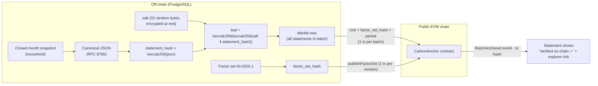

# Carbon Wallet — Blockchain Layer

> **Role of the chain: proof, not storage.** The blockchain calculates nothing and stores no personal
> data. It makes two things **tamper-evident and publicly verifiable**:
>
> 1. **Monthly Carbon Statements:** proof that a household's closed month was issued by us at a given time and never edited afterwards.
> 2. **Emission-factor sets:** proof that the methodology (e.g., CEA v22 = 0.675) wasn't quietly changed to inflate savings.
>
> Companion to [system_design.md](system_design.md) · [architecture.md](architecture.md) · [flaws.md](flaws.md) §G7

---

## 1. Why this is the right use (and what we deliberately avoid)

| We do | We don't |
|---|---|
| Anchor **Merkle roots** of salted statement hashes on-chain | Put kWh, AC hours, trips, or any personal data on-chain |
| Anchor **hashes of factor sets**, so the methodology is publicly locked per version | Mint tradeable tokens or "carbon credits" for savings (greenwashing, CCTS confusion, offset-scandal optics) |
| Let anyone verify a statement on a public `/verify` page or on-chain | Require users to install MetaMask or hold crypto; the server signs and users need no wallet |
| One transaction per batch, so cost is negligible | Write per-activity transactions |
| Keep the app fully functional if the chain is down (anchoring retries later) | Make the chain part of the calculation path |

**The problem it solves:** carbon numbers are only useful to a third party (employer, housing society, campus, judge) if that party can trust they weren't edited after the fact, and that the provider didn't change factors to make results look better. A public anchor provides that without having to trust us.

---

## 2. How it works



### 2.1 Statement contents (off-chain, downloadable by the user)

```json
{
  "type": "CarbonStatement/v1",
  "household_ref": "hh_7f3a…",             // random ID, not name/email
  "period": "2026-05",
  "total_kg": { "central": 448.0, "low": 400.0, "high": 502.0 },
  "by_category": { "electricity": 283.5, "transport": 74.0, "cooking": 42.4, "food": 48.1 },
  "verified_reductions_kg": 24.0,
  "tier_mix": { "bill_calibrated": 0.62, "declared": 0.30, "default": 0.08 },
  "factor_set": "IN-2026.1",
  "calc_version": "2026.10.0",
  "issued_at": "2026-06-03T03:00:00+05:30"
}
```

The user's downloadable file also includes `salt`, `leaf`, `merkle_proof[]`, `batch_id`, `chain_id`, `contract_address`, and `tx_hash`. With those, **anyone** can verify the statement independently.

### 2.2 Why salt

Carbon numbers have low entropy. Without a salt, someone could guess "283.5 kg electricity" and confirm it against an unsalted on-chain hash. The per-statement random salt prevents this. **Leaves are double-hashed** (OpenZeppelin convention) to block second-preimage attacks on the Merkle tree.

### 2.3 Privacy and DPDP erasure (crypto-shredding)

Only Merkle **roots** go on-chain. When a user exercises the right to erasure, we delete the statement data **and its salt**. The on-chain root is then mathematically unlinkable to that person, so nothing personal remains anywhere, and an immutable chain doesn't conflict with deletion.

---

## 3. Smart contract (Solidity, OpenZeppelin v5)

```solidity
// SPDX-License-Identifier: MIT
pragma solidity ^0.8.24;

import {Ownable} from "@openzeppelin/contracts/access/Ownable.sol";
import {MerkleProof} from "@openzeppelin/contracts/utils/cryptography/MerkleProof.sol";

contract CarbonAnchor is Ownable {
    struct Batch {
        bytes32 root;
        bytes32 factorSetHash;
        uint64 anchoredAt;
        string period;          // "2026-05"
    }

    Batch[] public batches;
    mapping(bytes32 => string) public factorSetVersion;   // hash => "IN-2026.1"

    event FactorSetPublished(bytes32 indexed hash, string version);
    event BatchAnchored(uint256 indexed id, bytes32 root, bytes32 indexed factorSetHash, string period);

    constructor() Ownable(msg.sender) {}

    function publishFactorSet(bytes32 hash, string calldata version) external onlyOwner {
        require(bytes(factorSetVersion[hash]).length == 0, "already published");
        factorSetVersion[hash] = version;
        emit FactorSetPublished(hash, version);
    }

    function anchor(bytes32 root, bytes32 factorSetHash, string calldata period)
        external onlyOwner returns (uint256 id)
    {
        require(bytes(factorSetVersion[factorSetHash]).length != 0, "unknown factor set");
        id = batches.length;
        batches.push(Batch(root, factorSetHash, uint64(block.timestamp), period));
        emit BatchAnchored(id, root, factorSetHash, period);
    }

    function verify(uint256 id, bytes32[] calldata proof, bytes32 leaf) external view returns (bool) {
        return MerkleProof.verify(proof, batches[id].root, leaf);
    }
}
```

- `onlyOwner` means only our anchoring key can write. Reads and `verify` are public and free (view calls).
- A batch can't reference a factor set that wasn't published first, which enforces "methodology before results".
- Tooling: **Foundry** (or Hardhat) for compile, tests, and deploy.

---

## 4. Backend changes (FastAPI)

### 4.1 New module and job

```
backend/app/modules/anchoring/
├── canonical.py      # RFC 8785 canonical JSON
├── merkle.py         # OZ-compatible tree (sorted-pair keccak256)
├── chain.py          # web3.py client: publishFactorSet, anchor, wait for receipt
├── service.py        # build batch → anchor → store proofs
└── router.py         # GET /statements/{id}, GET /statements/{id}/proof, POST /verify
```

```python
# merkle.py — compatible with OpenZeppelin MerkleProof (sorted pairs)
from eth_utils import keccak

def leaf(statement_json: bytes, salt: bytes) -> bytes:
    return keccak(keccak(salt + keccak(statement_json)))

def _parent(a: bytes, b: bytes) -> bytes:
    return keccak(min(a, b) + max(a, b))

def build(leaves: list[bytes]) -> tuple[bytes, list[list[bytes]]]:
    """Returns (root, proofs[i]) for each leaf."""
    level = list(leaves)
    proofs = [[] for _ in leaves]
    idx = list(range(len(leaves)))           # position of each original leaf in current level
    while len(level) > 1:
        nxt = []
        for i in range(0, len(level), 2):
            if i + 1 < len(level):
                nxt.append(_parent(level[i], level[i + 1]))
            else:
                nxt.append(level[i])         # odd node carried up, no sibling
        for j, p in enumerate(idx):
            sib = p ^ 1
            if sib < len(level):
                proofs[j].append(level[sib])
            idx[j] = p // 2
        level = nxt
    return level[0], proofs
```

| Job | Trigger | Work |
|---|---|---|
| `publish_factor_set_onchain(fsid)` | Admin publishes a factor set | Hash the canonical factor-set JSON → `publishFactorSet` |
| `anchor_statements(period)` | After `close_month` completes for all households (or daily for late restatements) | Build the batch Merkle tree → `anchor` → store root, tx hash, and per-statement proof |
| `retry_anchor` | Failed or pending tx | Exponential backoff. The app keeps working and shows "Anchoring pending" |

### 4.2 New tables

```sql
CREATE TABLE anchor_batches (
  id               uuid PRIMARY KEY DEFAULT gen_random_uuid(),
  period           text NOT NULL,
  merkle_root      bytea NOT NULL,
  factor_set_hash  bytea NOT NULL,
  chain_id         integer NOT NULL,
  contract_address text NOT NULL,
  onchain_batch_id bigint,
  tx_hash          text,
  block_number     bigint,
  status           text NOT NULL CHECK (status IN ('pending','submitted','confirmed','failed')),
  created_at       timestamptz NOT NULL DEFAULT now()
);

CREATE TABLE statements (
  id              uuid PRIMARY KEY DEFAULT gen_random_uuid(),
  household_id    uuid NOT NULL REFERENCES households(id) ON DELETE CASCADE,
  period          date NOT NULL,
  version         smallint NOT NULL DEFAULT 1,      -- restatement → new version, new anchor
  canonical_json  jsonb NOT NULL,
  statement_hash  bytea NOT NULL,
  salt_enc        bytea NOT NULL,                   -- encrypted; deleted on erasure (crypto-shred)
  leaf            bytea NOT NULL,
  merkle_proof    bytea[] ,
  batch_id        uuid REFERENCES anchor_batches(id),
  UNIQUE (household_id, period, version)
);
```

**Restatements:** if a later bill changes a closed month, a **new statement version** is issued and anchored. The old one stays verifiable as "superseded". History is never rewritten, only appended. This fits the append-only ledger (ADR-003).

### 4.3 Key management

- One **server-held anchoring key**, stored in the secret manager and never in the repo. The key only has permission to anchor; it holds no user funds.
- Hackathon: a testnet key funded from a faucet. Production: a hardware-backed or managed signer, plus a multisig as contract owner.

---

## 5. Frontend changes (React + TS)

| Where | What |
|---|---|
| Monthly report | **"Verified on-chain ✓"** badge with a block-explorer link to the tx |
| Methodology page | Each factor set shows its on-chain hash and a link to the `FactorSetPublished` event |
| Statement download | JSON (+ PDF) including the proof bundle |
| Public `/verify` page | Paste or upload a statement → the browser recomputes the leaf and verifies the Merkle proof against the on-chain root (read via **viem**; no wallet needed) → ✅ "Issued 3 Jun 2026, unaltered, methodology IN-2026.1" or ❌ "Altered / not found" |

Live demo moment: **edit one number in the downloaded statement and re-verify. It turns red ❌.**

---

## 6. Chain choice

| Context | Choice | Why |
|---|---|---|
| Hackathon | **The sponsor's EVM testnet** (e.g., Polygon Amoy, Base Sepolia, or Ethereum Sepolia) | Free, a public explorer link judges can click, and it may qualify you for sponsor prizes |
| Production v1 | A low-fee public EVM L2 | Public verifiability; one tx per batch keeps cost negligible |
| Production v2 (multi-party) | Consider a **permissioned ledger** shared with discoms, housing societies, and employers, or attestations (e.g., Ethereum Attestation Service) | This is the genuine multi-party trust case: partners co-sign verified reductions |

---

## 7. Optional extra: non-transferable achievement badges (only if judges want a user-facing token)

- A **soulbound (non-transferable)** badge for a *bill-verified* milestone, e.g. "3 months of verified AC reduction".
- **Opt-in only.** The user links their own wallet. No monetary value. It can't be transferred or sold, so it can't be confused with a carbon credit.
- **Risk:** wallet addresses are pseudonymous personal data, and badges are permanent. That's why this is off by default. Skip it unless the track requires a token.

---

## 8. Hackathon build plan (adds ~8–10 hours)

| Task | Time |
|---|---|
| `CarbonAnchor` contract + 4 Foundry tests (publish, anchor, unknown-set revert, verify) + testnet deploy | 2–3 h |
| `merkle.py` + `canonical.py` + golden test matching OpenZeppelin `MerkleProof` | 1–2 h |
| `anchor_statements` (run synchronously in the hackathon) + web3.py tx + store proofs | 2 h |
| `/verify` page with viem + "Verified on-chain" badge + explorer link | 2–3 h |
| Demo rehearsal: tamper → ❌ | 30 min |

---

## 9. Pitch framing and judge Q&A

**One line:** *"Blockchain doesn't calculate our carbon. It makes it tamper-evident. Every monthly carbon statement and every emission-factor version is anchored on-chain, so an employer, housing society, or anyone else can verify we never edited history or quietly changed the methodology. No personal data on-chain, no tokens, no wallet needed."*

| Likely question | Answer |
|---|---|
| "Why not just a database?" | Our database proves things to *us*. The anchor proves them to *third parties* without trusting us. That matters once employers or housing societies use the statements |
| "Isn't blockchain bad for the climate?" | It's one transaction per batch on a proof-of-stake chain, which is negligible next to one household's monthly footprint |
| "What about privacy and DPDP erasure?" | Only salted Merkle roots go on-chain. Deleting the salt crypto-shreds the link, so erasure still works |
| "Can users earn tokens?" | No, deliberately. Tradeable carbon tokens have a greenwashing history, and our product is about real reductions, not credits |
| "What if the chain is down?" | Anchoring is async and retried. The app never depends on it |
