# Carbon Wallet — Workflows

> User journeys, system pipelines, factor governance, the development workflow, and the build plan.
> Companion to [system_design.md](system_design.md) and [architecture.md](architecture.md).

---

## 1. The product loop

The original loop was *Track → Calculate → Compare → Predict → Act → Reward*. Two changes: **Verify** is added before Reward, and **Reward** is tied to *verified* reductions, not to logging.

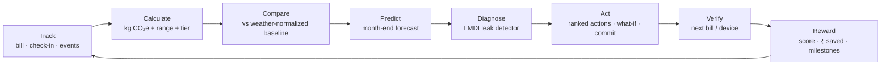

Friction budget per user: **≈ 5 min onboarding, ≈ 60 s/week, ≈ 1 min/month (bill)**. Any feature that adds to this budget has to pay for itself.

---

## 2. User workflows

### 2.1 Onboarding (target ≤ 5 minutes)

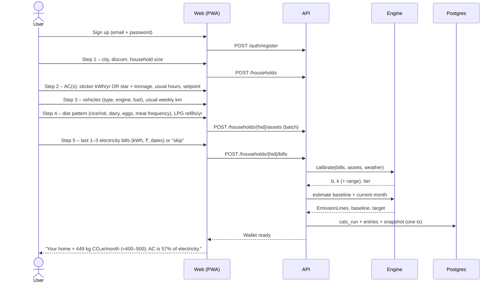

Design notes:

- Every step has a **"don't know" path** that falls back to a default tier. Skipping never blocks the user.
- AC sticker entry shows a photo hint of where the BEE label's kWh/year number sits.
- Bills: ask for **one winter and one summer bill** if available. This immediately enables the two-point calibration (system_design §5.3).
- First-screen honesty: show the range and a tier chip ("Estimate — add a bill to sharpen").

### 2.2 Weekly check-in (≈ 60 seconds)

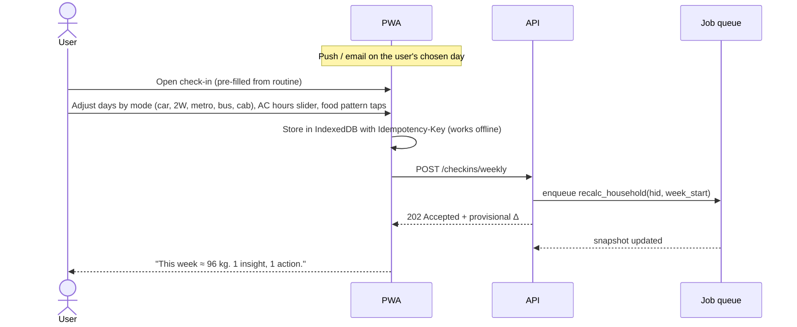

- Pre-filled from last week, so a "no change" check-in is a single tap.
- If the user misses a week, the system fills the gap from the routine estimate at a lower tier. **Gaps never count as zero.**

### 2.3 Monthly bill and calibration

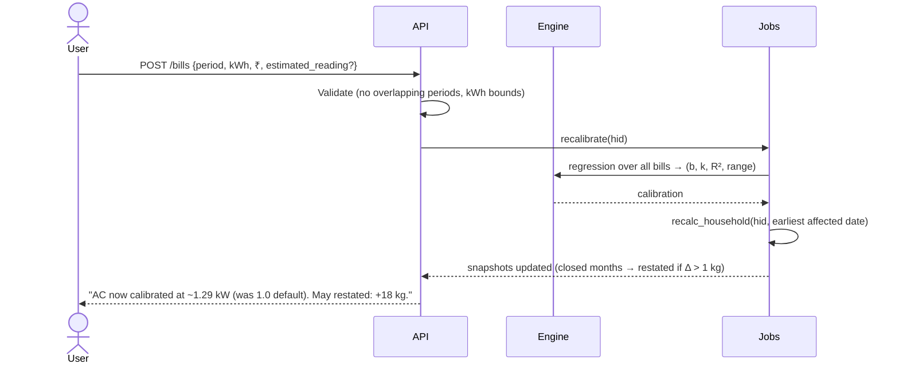

### 2.4 Month close and report

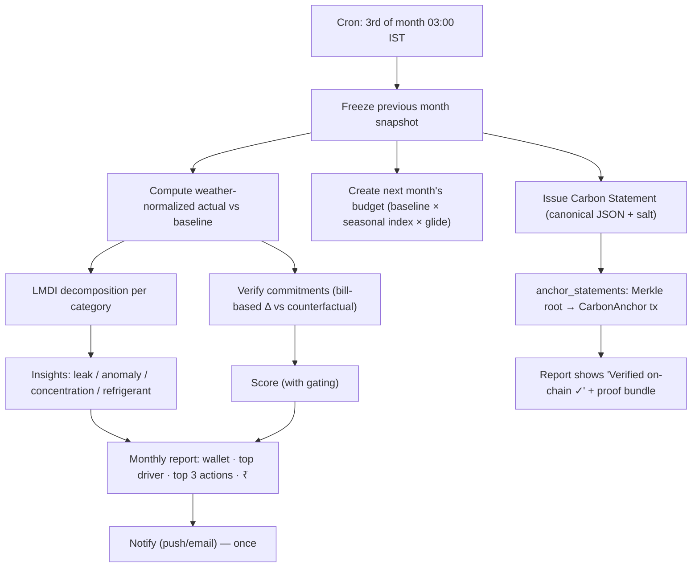

### 2.5 Leak → action → commitment → verification

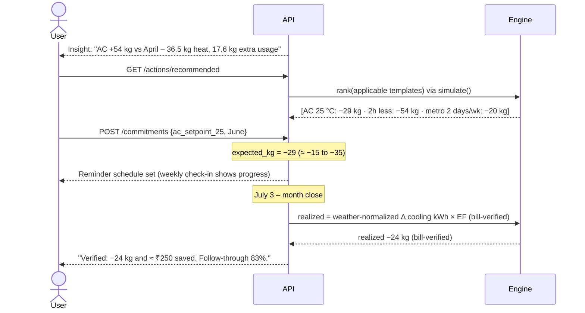

### 2.6 What-if simulator

1. The user opens `/simulate`. Sliders are pre-set to the current profile.
2. Each change makes a debounced `POST /simulations` with patches.
3. The engine runs `base` and `alt` for a typical month and for the season or year. Weather is normalized to the city's normal.
4. The response shows Δ kg (range), Δ kWh, and Δ ₹ at the household's marginal tariff slab.
5. "Make this a commitment" turns the scenario into an `action_commitment`.

### 2.7 Heatwave day handling

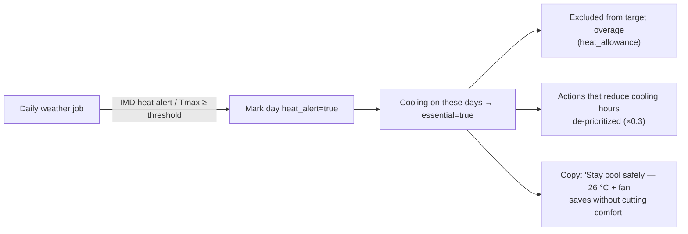

### 2.8 AC service / refrigerant event

1. The user taps **"AC gas refilled / serviced"** on the AC's asset page.
2. The form asks for refrigerant type (pre-filled from the asset), kg added (from the invoice if known, otherwise "don't know"), and whether a leak test was done.
3. The engine creates a Scope 1 line, e.g. 1 kg R-32 → 771 kg CO₂e (range 386–771 if unknown).
4. If there have been more than 1 refill in 24 months, a refrigerant insight fires and the action "Ask the technician for a leak test and repair before the next refill" is promoted.
5. These events are **not** charged against the monthly target as ordinary overage. They appear as a separate "one-off events" band in the month, so one event doesn't wreck the score. They do appear prominently in the annual view.

---

## 3. System workflows

### 3.1 Activity ingest → ledger

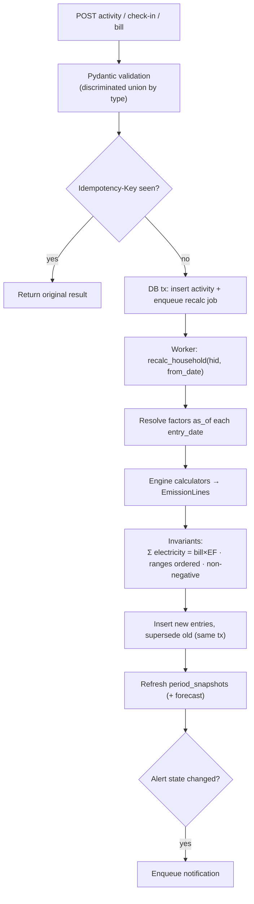

### 3.2 Forecast and alert evaluation (daily)

1. For each open month snapshot, compute `forecast = MTD + Σ remaining [w·recent + (1−w)·baseline×weather_adj]`.
2. Map to a state: on track (≤ 90% of target), watch (90–110%), or likely over (> 110%).
3. Notify **only on state transitions**, at most twice a week, to avoid alert fatigue.
4. A "likely over" notification always carries a computed recovery plan, never a bare warning.

### 3.3 Data deletion (DPDP)

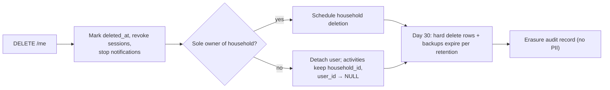

---

## 4. Emission-factor governance

Factors are code-reviewed data. **A number without a source cannot be merged.**

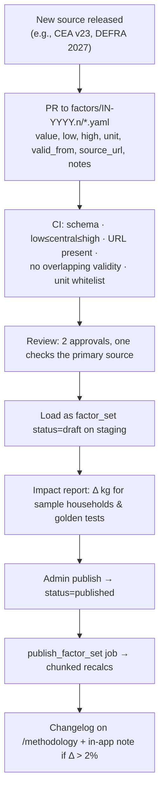

**Annual calendar:**

| When | Source | Action |
|---|---|---|
| ~Aug–Dec | CEA CO₂ Baseline Database (new FY) | Add a `grid.in.avg` row with `valid_from` = FY start; mark earlier provisional values final |
| ~Jun | DEFRA conversion factors | Update flight factors |
| As released | BEE star-label tables | Update `ac.kw.label` defaults (Jan 2026 band revision) |
| As released | MoP discom ratings | Update T&D / AT&C per state |
| Ad hoc | India-specific food/transport studies | Replace global or 2015 factors; mark `verified=true` only after reading the primary source |

Open verification tasks carried into factor set `IN-2026.1`: metro g/pkm (primary TERI source), paneer factor, refrigerant charge defaults, and post-BS-VI vehicle factors.

---

## 5. Development workflow

### 5.1 Local setup

```bash
git clone <repo> && cd carbon-wallet
docker compose up -d db                     # Postgres 16
cd backend && uv sync && uv run alembic upgrade head
uv run python -m app.scripts.load_factors factors/IN-2026.1
uv run python -m app.scripts.seed_demo      # Sharma household (demo)
uv run uvicorn app.main:app --reload
uv run python -m app.jobs.worker            # in another terminal
cd ../frontend && pnpm i && pnpm gen:api && pnpm dev
```

### 5.2 Branching and PRs

- Trunk-based: short-lived feature branches off `main`, squash-merged.
- Conventional commits (`feat(engine): add LMDI decomposition`).
- PR template checklist:
  - [ ] Engine change has golden and/or property tests
  - [ ] New factor has `source_url` and range rationale
  - [ ] Migration is backward compatible (expand → migrate → contract)
  - [ ] API change regenerates the TS client (`pnpm gen:api`)
  - [ ] UI shows ranges and tiers for any new kg value
  - [ ] Copy reviewed for the no-moralizing rule; Hindi string added

### 5.3 CI pipeline

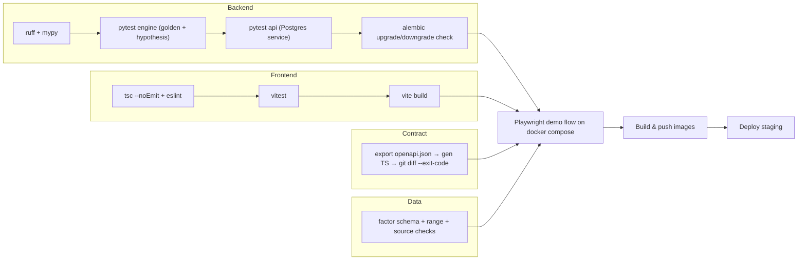

### 5.4 Definition of done (per feature)

- Numbers trace back to sources on the Methodology page.
- Works offline where relevant (check-ins).
- Has an empty state, an error state, and a "not enough data" state.
- Accessible: keyboard path, chart table fallback, contrast AA.
- Instrumented: at least one product metric event.

---

## 6. Build plan

### 6.1 Six-week MVP (2–3 developers)

| Week | Backend | Frontend | Exit criteria |
|---|---|---|---|
| 1 | Repo, auth, households, assets, factor tables + loader, `IN-2026.1` seed | Scaffold, auth, onboarding steps 1–4 | Can create a household with assets |
| 2 | Engine: electricity, AC sub-allocation, calibration, transport, LPG, food; ledger + calc runs | Bills screen, wallet v0 (totals + categories) | Sharma golden tests pass; wallet shows ranges |
| 3 | Weather job + CDD, baseline, targets, forecast, alert states | Weekly check-in (offline), wallet target bar + forecast | Forecast within ±10% on replayed demo data |
| 4 | LMDI insights, refrigerant events, simulator | Insights waterfall, asset page, simulator sliders | Demo steps 1–5 work end to end |
| 5 | Actions catalog (≈ 15 templates), ranking, recovery plan, commitments, month close, score | Plan screen, score screen, methodology page | Full loop incl. bill-verified commitment |
| 6 | Privacy (consents, export, delete), rate limits, observability, hardening | Hindi strings, PWA install, a11y pass | Pilot-ready; Playwright E2E green |

### 6.2 48-hour hackathon cut

| Keep | Drop or fake |
|---|---|
| Onboarding (city, 1 AC, 1 vehicle) | Auth (single demo user) |
| Two bills → calibration → AC share | Jobs (compute synchronously) |
| LMDI with hard-coded CDD for 2 months | Weather API |
| Simulator (AC hours, setpoint, car → metro) | Commitments and verification |
| Refrigerant event → 771 kg spike | Score (show a static breakdown) |
| Methodology page with sources | Hindi, PWA |
| **On-chain anchoring** (contract on testnet, synchronous anchor, `/verify` page with tamper demo) — required track; ~8–10 h, see [blockchain.md](blockchain.md) §8 | Soulbound badges |

### 6.3 Pilot plan (after MVP)

- **Cohort:** 30–50 households (a campus or an RWA), 8 weeks spanning a season change if possible.
- **Primary metrics:** % households with ≥ 2 bills (calibration coverage), weekly check-in completion at week 4 and week 8, number of bill-verified commitments, D30 retention.
- **Kill or pivot thresholds** are in [flaws.md](flaws.md) §G.

---

## 7. Demo script (≈ 3 minutes)

| # | Screen | Say | Show |
|---|---|---|---|
| 1 | Onboarding | "Sharma family, Delhi, 4 people, one 1.5-ton 3-star AC, a petrol hatchback." | 45-second wizard |
| 2 | Bills | "Two numbers from their bills: January 180 units, May 420." | Calibration card: **AC ≈ 1.29 kW**, label would say 0.69 |
| 3 | Wallet | "AC is 57% of their electricity — 162 kg in May, ± range, bill-calibrated." | Range + tier chip |
| 4 | Insights | "May vs April: +54 kg. Two-thirds is the heatwave — not their fault. 17.6 kg is extra usage." | LMDI waterfall |
| 5 | Simulate | "Two hours less a day: −54 kg and about ₹560 this month, −319 kg this season." | Sliders |
| 6 | Asset | "They topped up AC gas last month. That one refill ≈ 771 kg — more than 4 months of AC electricity." | Refrigerant spike + leak-test action |
| 7 | Plan | "Commit to 25 °C. Next bill verifies it." | Commitment → verified badge |
| 8 | Methodology | "Every number links to its source — CEA v22, India GHG Program, Vetter 2017." | Factor table |
| 9 | Verify | "And you don't have to trust us. This month's statement and our factor set are anchored on-chain. Watch — I change one number…" | `/verify` ✅ → edit the JSON → ❌; explorer link |
