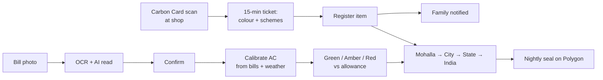
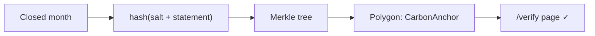
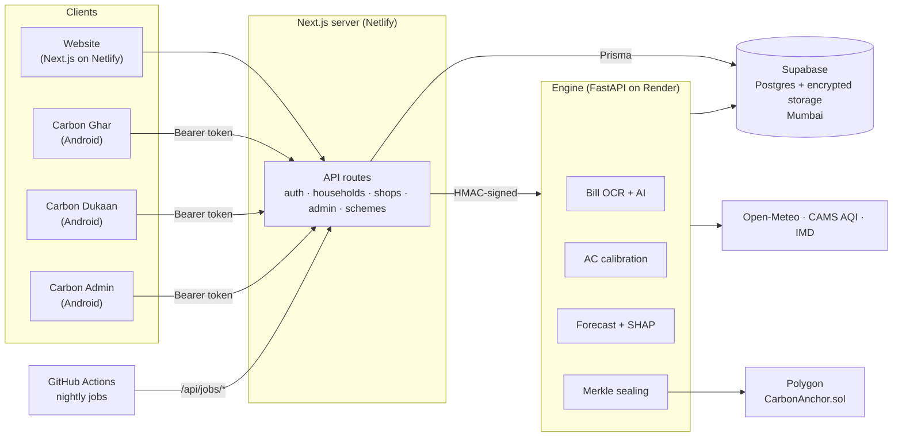
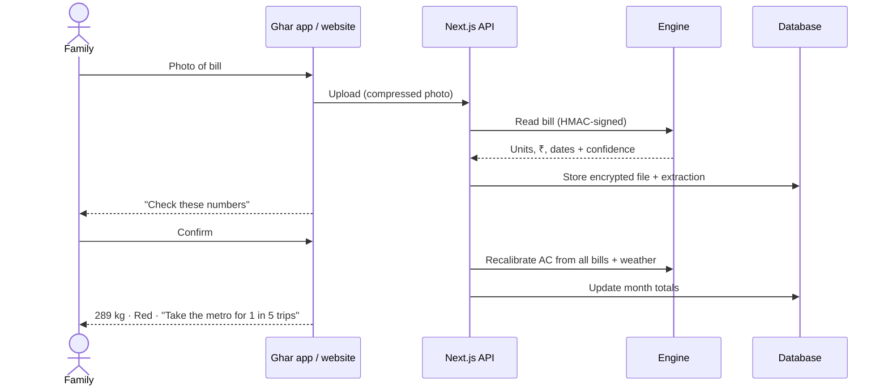
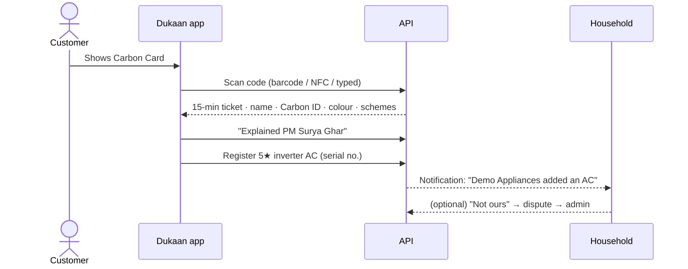

# Carbon Wallet: PPT content

Slide-by-slide content for the presentation. Each slide has the text to put **on the slide**, a suggested **visual**,
and **speaker notes** (what to say). Numbers come from the repo's docs (`Docs/`, `PLAN-V2.md`, `README.md`) and the
running demo database; the demo data is mostly synthetic (1,823 of 1,834 homes), and slides say so where it matters.

Suggested length: 18 main slides plus 3 backup slides, about 8–10 minutes with a 3-minute live demo.

---

## Slide 1: Title

**On the slide**
- **Carbon Wallet · कार्बन वॉलेट**
- *हर घर का कार्बन खाता: every home's carbon account*
- Household carbon accounting for India, built around one **Carbon Card** per home
- Team name · members · event

**Visual:** the Carbon Wallet seal (home + leaf in a navy ring), tricolour hairline at the top, the printed Carbon Card
(CW-UP-26-0001-5) on the side.

**Speaker notes:** "Carbon Wallet gives every Indian home a carbon account, the way a bank gives it a passbook. One card,
your electricity bill, and the shops you already buy from. Nothing to log by hand."

---

## Slide 2: The problem

**On the slide**
- Indian ACs emitted **~156 Mt CO₂e in 2024**, about as much as **all passenger cars** in India
- AC stock is set to grow **62 million → 245 million by 2035**
- Families **don't know** their carbon: no meter for it, no bill for it
- Carbon apps ask people to **log every day**, and most users quit within **1–2 weeks**
- Families also miss **government benefits** they qualify for (rooftop solar, e-scooter, AC exchange, scrappage)

**Visual:** a rising AC-stock line chart (62M → 245M) next to a car icon with "≈ same CO₂".

**Speaker notes:** "Household cooling is India's fastest-growing load, and nobody measures it at home. The tools that
exist either want you to log every meal and trip, which nobody keeps doing, or give you a one-time quiz score. And
the subsidies that would actually cut a home's carbon, like PM Surya Ghar, stay unclaimed because families never
hear about them at the moment they buy."

---

## Slide 3: Why today's solutions fall short

**On the slide**

| Approach | What goes wrong |
|---|---|
| Pledge apps (e.g. Meri LiFE) | Promises, no measurement |
| Static carbon quizzes | One score, never updated |
| Spend-based calculators | Guesses from money, not energy |
| Manual logging apps | Logging fatigue: users drop off in weeks |
| AC estimates from the star label | Under-count real use about **2.6×** (label 0.44 kW vs field 1.16 kW, Prayas survey) |
| Most calculators | Numbers disagree by tonnes, so nobody trusts them |

**Visual:** the table, with the last two rows highlighted.

**Speaker notes:** "Two things kill this category: effort and trust. If it needs effort, people stop. If the numbers
can't be checked, nobody acts on them. We designed against both."

---

## Slide 4: Our solution in one line

**On the slide**
> **Every home gets a Carbon Card. The family only adds its electricity bill; the shop that sells an AC, fridge or
> scooter registers it on the card. From bills and registered items we know each home's real carbon, show it as
> Green / Amber / Red, connect the family to the government schemes that fit, and seal the record on a public
> blockchain.**

Four pillars:
1. **No logging:** bill photo + shop registration
2. **Honest numbers:** calibrated from the home's own bills, with sources
3. **Bridge to schemes:** the shop counter tells the buyer which subsidies they get
4. **Verifiable:** monthly records sealed on chain, checkable by a bank or employer

**Visual:** four icons in a row: bill · shop · government building · shield-check.

**Speaker notes:** "The household's only job is the electricity bill photo, about one minute a month. Everything else
comes from the shop counter, where the purchase decision actually happens."

---

## Slide 5: Who uses it

**On the slide**

| User | Where | What they do |
|---|---|---|
| **Household** (Owner, Family, View-only) | Website + **Carbon Ghar** Android app | Add bill photos, see their colour and one thing to do, mohalla news, Carbon Card, schemes |
| **Shop** (approved by admin) | Website + **Carbon Dukaan** Android app | Scan the card, see the home's colour + eligible schemes, register what was sold |
| **Admin** (Carbon Wallet staff) | Website + **Carbon Admin** Android app | Approve shops, decide removal requests, answer complaints, keep the scheme list current |
| **Anyone** | Public pages | Verify a sealed month, open data by area, methodology |

**Visual:** three phone mock-ups side by side (Ghar · Dukaan · Admin).

**Speaker notes:** "Three roles, each with its own native app and its own web portal, all on one backend."

---

## Slide 6: How it works (end-to-end flow)

**On the slide**
1. Family photographs the **electricity bill** → our engine reads the units (OCR, Hindi + English) → family confirms
2. Engine **calibrates** the home's real AC power from its bills and the weather
3. Home gets **Green / Amber / Red** against its allowance (people × state average)
4. At a shop, the family shows the **Carbon Card** → shop scans barcode / NFC chip
5. Shop sees only the **colour + schemes that fit**, never the bills → registers the item from its catalogue
6. Family gets a notification; can tap **"Not ours"** if wrong
7. Homes are grouped into **mohallas (~40 homes)** → city → state → India totals, with weather and air quality
8. Every night, records are **sealed on Polygon** as Merkle roots

**Visual:**

**Speaker notes:** "Data enters at two points, the bill and the shop counter, and flows up into a picture of the whole
country, mohalla by mohalla."

---

## Slide 7: Household features (Carbon Ghar)

**On the slide**
- **Mera Ghar:** one big number, a meter against the allowance, Green / Amber / Red with a word and an icon,
  "8% less than last month", **one thing to do** (₹ and kg saved), 6-month graph, "where it went"
- **Bijli Bill:** camera opens at once; we read the bill; family checks and confirms; AC's real power shown
- **Mohalla:** my home vs mohalla vs city vs state vs India; weather, 7-day forecast, AQI; "Aaj ka Mohalla" news
- **Card aur Saman:** Carbon Card with the private barcode (screen goes full-bright for scanners); items added by
  shops; ask to remove an item with photos, an admin decides
- **Sarkari Yojana:** schemes this home qualifies for, how much (e.g. **₹30,000** PM Surya Ghar), steps, documents,
  one-tap helpline call, official link

**Visual:** screenshots from the Ghar app: Mera Ghar meter (289 kg, Red), Carbon Card, Yojana card.

**Speaker notes:** "Designed for someone with little schooling on a ₹8,000 phone: one number, one colour, one action
per screen, Hindi first, text size A / A+ / A++, and every number in ₹ as well as kg."

---

## Slide 8: Shop counter and admin features

**On the slide**

**Carbon Dukaan (shop)**
- Opens straight on **Scan card**: camera barcode (on-device ML Kit, works offline), NFC tap, or typed code
- Sees the home's **colour + one sentence**, and the **benefits that fit what the shop sells**
- Marks **"I explained it" / "Helped apply"**, so the family sees the shop's help
- Picks the product from its **catalogue** (BEE stars, yearly kWh, running cost, CO₂) → enters serial/VIN → registered
- Dashboard: items, homes served, **efficient share (41%)**, sales value, disputes

**Carbon Admin**
- Approve or suspend shops
- Decide **removal requests** with the home's photos and bill history
- Help desk tickets with replies; keep schemes current ("checked today", show / hide)
- Forecast model health, audit log, scheduled erasures

**Visual:** Dukaan counter screen (Red · Sharma Residence · PM Surya Ghar · 14:55 timer) and the Admin overview.

**Speaker notes:** "The shop is where carbon is decided: a 3-star or a 5-star AC is a ten-year decision. We put the
carbon status and the subsidy in front of the buyer at exactly that moment."

---

## Slide 9: The science: how we count

**On the slide**
- Grid factor: **CEA CO₂ Baseline Database v22.0, FY 2025-26: 0.675 kg CO₂/kWh**, versioned per year
- **AC power calibrated from the home's own bills:**
  `kWh(bill) = baseload × days + AC_kW × AC_hours` → solved across bills
  - Example (Sharma home): Jan 180 units, May 420 units → **AC ≈ 1.29 kW** (label says 0.69) → **162 kg in May, 57% of electricity**
- **Refrigerant leaks counted:** one 1 kg R-32 top-up ≈ **771 kg CO₂e**, more than 4 months of AC electricity
- **Weather-normalized:** a cool month isn't credited as improvement; heatwave cooling is tagged essential
- **Allowance** = people × state average per person; **≤ 90% Green · ≤ 110% Amber · above that Red**
- Every number has a **range, a data tier and a source**; AI never produces a number

**Visual:** the worked example as a small table, and the formula.

**Speaker notes:** "Label-based estimates undercount ACs by about 2.6 times. We measure each home's AC from its own
bills, so the advice is about this home, not an average."

---

## Slide 10: AI and machine learning

**On the slide**

| Part | How | Result |
|---|---|---|
| **Bill reading** | OpenCV clean-up + Tesseract OCR (Hindi + English), PDF text when available; an AI vision model only if unsure and the family allows it | Units, ₹, dates with a confidence per field |
| **AC calibration** | Least-squares regression over the home's bills and cooling degree days | Real kW per home |
| **Next-month forecast** | Gradient-boosted trees (scikit-learn HistGradientBoosting), 10th–90th percentile range | Typical error **5.2 kg (3.3%)** vs 7.7 kg for "same as last month"; R² **0.989** on held-out data |
| **Why it changed** | SHAP explanations | Top driver: "hotter or cooler than last month" (36%) |
| **Mohalla news** | Template facts + LLM wording + translation | Short stories in the user's language; every number from data |

Trained on 1,833 homes · 40,206 home-months (Dec 2024 – Sep 2026), mostly synthetic demo homes.

**Visual:** bar chart of the five SHAP drivers; forecast error comparison (model 5.2 · last month 7.7 · last year 10.2).

**Speaker notes:** "AI reads and explains; it never invents numbers. Every kg on screen comes from a formula and a
versioned factor table."

---

## Slide 11: Blockchain: proof, not storage

**On the slide**
- Each closed month → canonical JSON → **salted hash** → Merkle tree → **one root per batch** on chain
- Smart contract **CarbonAnchor.sol** (OpenZeppelin `Ownable` + `MerkleProof`) on **Polygon (Amoy testnet)**
- Nightly batches also seal platform events: shop registrations, removal decisions, scheme help, area totals
- Public **/verify** page: a bank or employer checks a month without trusting us; edit one number and it fails
- **No personal data on chain, no tokens, no crypto wallet needed**
- DPDP erasure still works: deleting the salt **crypto-shreds** the link

**Visual:**

**Speaker notes:** "Our database proves things to us. The chain proves them to everyone else. It's one transaction a
day, on proof-of-stake, so the footprint is negligible."

---

## Slide 12: Tech stack

**On the slide**

| Layer | Technology |
|---|---|
| **Website** | Next.js 15 (App Router), React 19, TypeScript, Tailwind CSS, TanStack Query, Zustand, Zod, Sonner, Framer Motion |
| **Maps & areas** | Leaflet + OpenStreetMap, Uber **H3** hexagons (mohallas) |
| **Android apps (3)** | Kotlin, **Jetpack Compose**, Material 3, OkHttp, kotlinx.serialization, Coil; CameraX + **ML Kit** barcode; NFC; Credential Manager (Google sign-in); Android Keystore |
| **API & data** | Next.js route handlers, **Prisma 6**; SQLite (local) → **PostgreSQL on Supabase** (Mumbai) |
| **Engine** | **FastAPI** (Python), SQLAlchemy, NumPy, OpenCV, Tesseract, pdfplumber, scikit-learn, **SHAP** |
| **AI** | OCR first; AI vision fallback (NVIDIA NIM / Claude) only with consent; LLM translation |
| **Blockchain** | Solidity + OpenZeppelin, **web3.py**, Polygon Amoy |
| **Weather & air** | Open-Meteo forecast + CAMS air quality (Indian AQI), IMD |
| **Notifications** | Web Push (VAPID); FCM planned for Android |
| **Security** | AES-256-GCM files at rest, HMAC-signed web → engine calls, hashed session tokens, rate limits, CSP / HSTS |
| **Hosting** | **Netlify** (website), **Render** (engine, Docker), **Supabase** (Postgres + storage) |
| **Quality** | Vitest (167 tests), pytest (134 tests), GitHub Actions CI + scheduled jobs |

**Visual:** logos grouped by layer.

**Speaker notes:** "Two languages on the server: TypeScript for the product, Python for the maths and ML, with a
clean boundary between them."

---

## Slide 13: System architecture

**On the slide**

- **One backend for all clients:** the website and the three apps call the same API, so rules live in one place
- The **engine** does the maths and AI; pages never wait on it except bill reading and sealing
- Scheduled jobs: reminders, mohalla grouping, area totals, erasures, nightly seal, database keep-alive

**Speaker notes:** "A modular monolith: one product server, one maths engine, one database. The load is small; the
hard problems are correctness and trust, not scale."

---

## Slide 14: Workflow 1: bill to colour

**On the slide**

**Speaker notes:** "About one minute a month for the family. The original photo can be deleted after confirmation;
only the numbers are kept, and the consumer number is masked."

---

## Slide 15: Workflow 2: shop counter

**On the slide**

- The shop sees **only** colour, name, city and Carbon ID; never bills or numbers
- A ticket lasts 15 minutes and covers up to 10 items
- Disputes count against the shop; admins can suspend it

**Speaker notes:** "The card holds a private code; any other scanner sees a meaningless string. Shared public links are
refused at the counter."

---

## Slide 16: Problems we faced and how we solved them

**On the slide**

| Problem | Our solution |
|---|---|
| People stop logging | No logging: **bill photo once a month + shops register purchases** |
| Star labels under-count ACs (~2.6×) | **Calibrate each AC from the home's own bills** and the weather |
| Numbers nobody trusts | **Ranges, data tiers, cited sources**, open methodology, **on-chain seals** |
| Heat isn't the family's fault | **Weather-normalized**; heatwave cooling tagged essential, never shamed |
| Shops could add fake items | **Admin approval**, 15-min tickets, family's **"Not ours"** counted against the shop |
| Families could hide items | Items can't be deleted, only **requested for removal with photos**, an admin decides |
| Privacy | Areas shown only from **20+ homes**, hashes only on chain, files **AES-256 encrypted**, DPDP export + erase |
| Low literacy, many languages | **Hindi first**, icons + words, one number per screen, text size A / A+ / A++ |
| Cheap phones, weak 4G | **Native apps 2.5–13 MB**, cached screens open offline, data prefetched after sign-in |
| Subsidies never reach families | **Scheme finder at the shop counter**, with steps, documents and the helpline |

**Visual:** two-column "problem → solution" layout with icons.

**Speaker notes:** pick three to say out loud: logging fatigue, the AC under-count, and trust.

---

## Slide 17: Native apps built for a ₹8,000 phone

**On the slide**
- **Real native apps** (Kotlin + Jetpack Compose), not a website in a wrapper
- Same look as the website: Carbon Ledger colours, IBM Plex + Newsreader fonts, portal header with tricolour rule,
  "What's new" ticker, A / A+ / A++, Hindi / English
- **Fast:** opens on the last saved data, refreshes in the background; all tabs prefetched after sign-in;
  one warm connection; charts drawn natively
- **Small:** Ghar **3.1 MB**, Admin **2.5 MB**, Dukaan **12.8 MB** (includes the offline barcode reader)
- **Secure:** session token encrypted in the Android Keystore, HTTPS-only release builds, role checked on every call
- Admin overview trimmed for phones: **433 KB → 7 KB**

**Visual:** the three app icons (navy house, terracotta shop, black shield) and APK sizes as a bar chart.

**Speaker notes:** "Shops scan at a busy counter, often on weak data. The scanner works offline and the screens open
instantly from cache."

---

## Slide 18: Impact

**On the slide**

**One purchase decision, one AC, one year** (from the demo shop's catalogue, 1.5-ton split AC):

| | 3★ fixed speed | 5★ inverter | Saving |
|---|---:|---:|---:|
| Running cost / year | ₹8,050 | ₹5,740 | **₹2,310** |
| CO₂e / year | 780 kg | 556 kg | **224 kg** |

- Over a 10-year AC life: **~2.2 t CO₂e and ~₹23,000** saved per AC
- Scale: 245 million ACs by 2035; every efficient swap at the counter compounds
- Plus schemes the family would have missed: e.g. **₹30,000** rooftop solar subsidy for the Sharma home
- Platform (demo data): **1,834 homes · 47 mohallas · 3 shops · 6 government schemes**

**Visual:** the comparison table and a "10 years" callout.

**Speaker notes:** "We don't sell carbon credits. The impact is a better decision at the counter, plus money the
family is already entitled to."

---

## Slide 19: Business model and partners

**On the slide**
- **Free for households** (bill check, AC health check, scheme finder, Carbon Card, green-loan certificate)
- **B2B2C partners:**
  - **Discoms:** bill data and AC-exchange programmes
  - **Banks:** verified, sealed months for green loans
  - **RWAs, campuses, employers:** mohalla and team programmes
  - **Appliance and vehicle shops:** "green seller" score, footfall from scheme help
  - **Government:** area-level open data, scheme reach measured at the counter
- No tokens, no offsets, no selling personal data

**Visual:** a hub-and-spoke diagram with the household at the centre.

**Speaker notes:** "Household apps alone struggle to earn money. Partners who already hold the data or the customer
make it sustainable."

---

## Slide 20: Roadmap

**On the slide**
- **Now (done):** website for 3 roles, 3 native Android apps, bill OCR, AC calibration, forecasts with SHAP,
  mohalla news, scheme finder, on-chain sealing, encrypted storage, deploy configs (Netlify + Render + Supabase)
- **Next:** Play Store release; phone notifications (Firebase Cloud Messaging); voice in Indian languages
  (Bhashini: "Is mahine kitna hua?"); purchase-time "hours of use" model; undeclared-load detection
- **Later:** discom / smart-meter data feeds; smart-plug pilot to validate AC calibration; green-loan partner bank;
  pilot with an RWA showing bill-verified reductions

**Visual:** a three-column timeline.

---

## Slide 21: Thank you · Q&A

**On the slide**
- **Carbon Wallet: हर घर का कार्बन खाता**
- Live demo: website `localhost:3000` · apps on Android
- Repo: github.com/kritxnshu/Carbon-Wallet
- Team names and contacts

---

# Backup slides

## Backup A: 3-minute live demo script

| # | Show | Say |
|---|---|---|
| 1 | Ghar app → sign in as Sharma Residence | "A family of four in Greater Noida." |
| 2 | Mera Ghar | "289 kg this month: Red, 217% of their allowance, but 8% better than last month. One thing to do: metro for 1 in 5 car trips, saves ₹327." |
| 3 | Bijli Bill | "They only add a bill photo. We read it and measured their AC: about 0.3 kW from two bills." |
| 4 | Card aur Saman | "This is their Carbon Card: same code as the printed one." |
| 5 | Dukaan app → scan the printed card | "At the shop: Red, so suggest a 5-star inverter, and PM Surya Ghar fits this home: ₹30,000." |
| 6 | Register a 5★ AC from the catalogue | "Registered; the family is notified at once." |
| 7 | Admin app | "Admins approve shops and decide removal requests, with the family's photos." |
| 8 | /verify page | "And anyone can check that a sealed month was never edited." |

## Backup B: Likely judge questions

| Question | Answer |
|---|---|
| Why not just a database? | The database proves things to us; the chain proves them to a bank or employer without trusting us |
| Isn't blockchain bad for the climate? | One transaction a day on proof-of-stake; negligible next to one home's monthly footprint |
| What about privacy and the DPDP Act? | Only salted hashes on chain; area totals only from 20+ homes; export and erase built in; erasing the salt crypto-shreds the link |
| Can users earn tokens or credits? | No, deliberately. Carbon tokens have a greenwashing history; we focus on real reductions |
| What if the family enters a wrong bill? | Each field shows a confidence; the family confirms; sudden jumps are flagged |
| How accurate is the forecast? | Typical error 5.2 kg (3.3%) on held-out data, better than "same as last month" (7.7 kg); demo data is mostly synthetic |
| What stops a shop adding fake items? | Admin approval, 15-minute tickets, the family's "Not ours", and disputes counted against the shop |
| Why will people keep using it? | No daily logging; the bill is monthly anyway; free bill check, AC check and scheme finder give a reason to open it |

## Backup C: Known limitations (honest slide)

- Bills cover the whole home, so per-person numbers are divided, not measured
- AC hours and AC power can't be fully separated from bills alone; ranges stay wide until more bills or a smart plug
- We track home electricity, cooking gas and private vehicles, not everything a person causes
- Free hosting tiers sleep when idle; switch the engine to a paid plan for judging days
- Most of the demo dataset is synthetic; real-home results need a pilot
